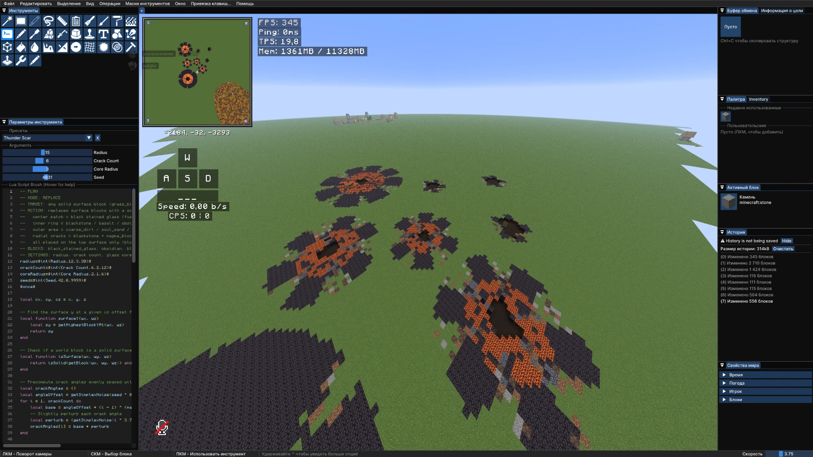
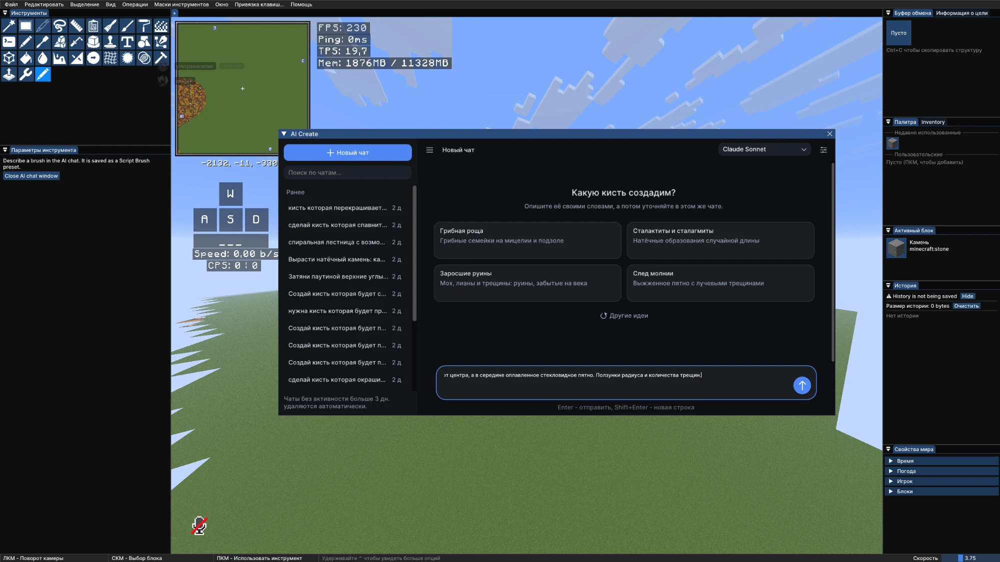
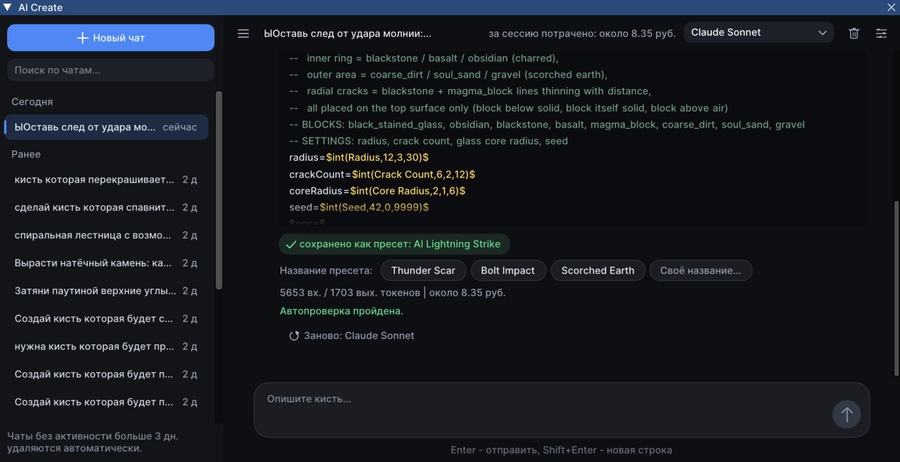

# Axiom AI Addon

[English](#english) | [Русский](#русский)

---

## English

A Fabric addon for the Minecraft building mod [Axiom](https://axiom.moulberry.com/). It adds an **AI Create** tool: describe a brush in plain words (in any language) and the addon writes a ready **Script Brush** preset for you.



| Start screen | Result with auto-check |
|---|---|
|  |  |

### Features

- **Chat inside Axiom.** Open the *AI Create* tool in the Tools panel and describe the brush. Follow-up messages adjust the same brush.
- **Saves a real Axiom preset.** The result is written to `config/axiom/tool_presets/script_brush` and the preset list refreshes automatically.
- **Switch models on the fly.** If a cheap model (for example DeepSeek) did not handle the request, pick a stronger one in the chat and press *Regenerate*. The same conversation continues with the new model.
- **Automatic test and repair.** The generated Lua script is checked in a simulated world. If it fails, the AI gets the error and repairs the script (number of attempts is configurable).
- **Several AI providers.** GigaChat out of the box, plus any OpenAI-compatible endpoint. Tested with DeepSeek, Claude Sonnet and Claude Haiku.
- **Model picker with price tracking.** Define several models in the config (for example a cheap fast one like Haiku and a stronger one like Sonnet), choose one in the chat, see tokens used and the estimated cost in rubles. An optional stronger model can be asked once if the chosen one keeps failing.
- **Start-screen ideas.** Ready brush ideas (overgrown ruins, cherry petals, icicles, lava cracks, coral reef and more).
- **Russian and English interface.** Follows the computer language by default.
- **Chat history** with automatic cleanup after N days.

### Requirements

- Minecraft **26.1.2**, Fabric Loader **0.19.5+**, Fabric API
- Java **25**
- Axiom installed (the addon does nothing without it)
- An API key for GigaChat or another OpenAI-compatible service

### Installation

1. Put `AxiomAIAddon-<version>.jar` into your `mods` folder next to Axiom.
2. Start the game once. The addon creates `config/axiom_ai_addon/config.json`.
3. Open `config.json` and paste your key:
   - **GigaChat:** set `gigachatAuthKey`. The two Russian trusted CA certificates (`russian_trusted_root_ca_pem.crt`, `russian_trusted_sub_ca_pem.crt`) must be in the same folder.
   - **DeepSeek or another OpenAI-compatible API:** set `"provider": "openai"`, then `openaiBaseUrl`, `openaiApiKey` and `openaiModel`.
4. Restart the game, open Axiom, pick the **AI Create** tool.

Never share your `config.json`: it contains your API key.

### Build from source

Put `axiom.jar` and `axiomclientapi.jar` (from your Axiom install) into `libs/`, then run:

```
./gradlew build
```

The jar appears in `build/libs`.

### License

[MIT](LICENSE.txt). Axiom itself is a separate product with its own license and is not included in this repository.

---

## Русский

Аддон для Fabric к моду [Axiom](https://axiom.moulberry.com/). Добавляет инструмент **AI Create**: описываешь кисть обычными словами (на любом языке), а аддон пишет готовый пресет **Script Brush**.


| Стартовый экран | Результат с автопроверкой |
|---|---|
|  |  |

### Возможности

- **Чат прямо в Axiom.** Открываешь инструмент *AI Create* в панели Tools и описываешь кисть. Следующие сообщения правят ту же кисть.
- **Настоящий пресет Axiom.** Результат сохраняется в `config/axiom/tool_presets/script_brush`, список пресетов обновляется сам.
- **Смена модели прямо в чате.** Если дешёвая модель (например, DeepSeek) не справилась с запросом, выбери в чате более сильную и нажми «Заново». Тот же разговор продолжится уже с новой моделью.
- **Автотест и исправление.** Lua-скрипт проверяется в симулированном мире. Если есть ошибка, ИИ получает её и исправляет скрипт (число попыток настраивается).
- **Несколько провайдеров ИИ.** GigaChat из коробки, а также любой OpenAI-совместимый сервер. Проверено с DeepSeek, Claude Sonnet и Claude Haiku.
- **Выбор модели и учёт стоимости.** В конфиге можно описать несколько моделей (например, дешёвую быструю вроде Haiku и более сильную вроде Sonnet), в чате выбрать нужную и увидеть расход токенов и примерную цену в рублях. Если выбранная модель не справляется, можно один раз позвать более сильную.
- **Идеи на стартовом экране:** заросшие руины, лепестки сакуры, сосульки, лавовые трещины, коралловый риф и другие.
- **Интерфейс на русском и английском.** По умолчанию выбирается язык компьютера.
- **История чатов** с автоочисткой через заданное число дней.

### Требования

- Minecraft **26.1.2**, Fabric Loader **0.19.5+**, Fabric API
- Java **25**
- Установленный Axiom (без него аддон ничего не делает)
- API-ключ GigaChat или другого OpenAI-совместимого сервиса

### Установка

1. Положи `AxiomAIAddon-<версия>.jar` в папку `mods` рядом с Axiom.
2. Запусти игру один раз: аддон создаст `config/axiom_ai_addon/config.json`.
3. Открой `config.json` и вставь ключ:
   - **GigaChat:** впиши `gigachatAuthKey`. Два российских сертификата (`russian_trusted_root_ca_pem.crt`, `russian_trusted_sub_ca_pem.crt`) должны лежать в той же папке.
   - **DeepSeek или другой OpenAI-совместимый API:** поставь `"provider": "openai"` и заполни `openaiBaseUrl`, `openaiApiKey`, `openaiModel`.
4. Перезапусти игру, открой Axiom и выбери инструмент **AI Create**.

Никому не показывай свой `config.json`: в нём лежит твой API-ключ.

### Сборка из исходников

Положи `axiom.jar` и `axiomclientapi.jar` (из своей установки Axiom) в папку `libs/` и выполни:

```
./gradlew build
```

Готовый jar появится в `build/libs`.

### Лицензия

[MIT](LICENSE.txt). Сам Axiom это отдельный продукт со своей лицензией, в этот репозиторий он не входит.
